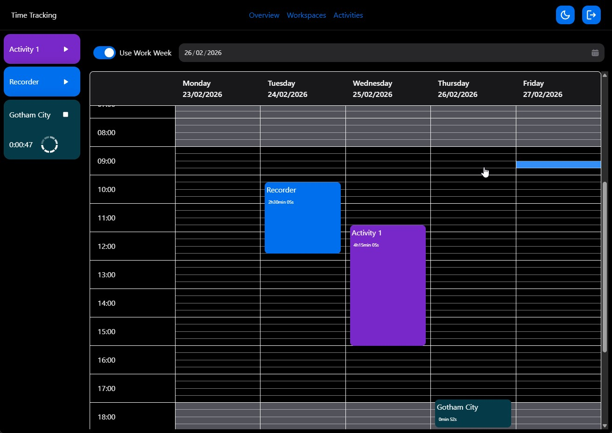
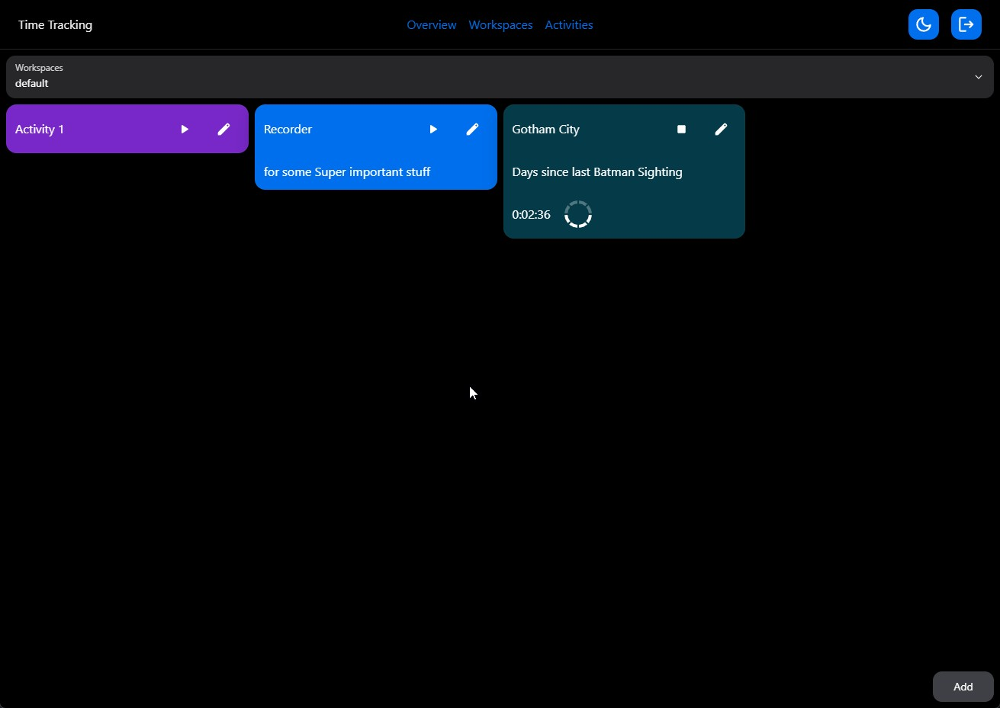

# ✨ Time Tracking

A self-hosted, activity-based time tracking application built for precision and flexibility.

---

## 🎯 Overview

Take control of your time with an intuitive, self-hosted time tracking solution. Create workspaces, manage activities, and track your productivity in real-time—all with the flexibility to store your data exactly where you want it.





---

## 🚀 Quick Start

Get up and running in minutes with Docker Compose. The secrets (token signing key, database password) are read from
a `.env` file next to the compose file, which is ignored by git:

```shell script
cp .env.example .env
# fill in TokenSecret (e.g. with the output of: openssl rand -hex 64) and POSTGRES_PASSWORD

docker-compose up

# for the more adventures
docker-compose up -d
```


See the [Compose File](./docker-compose.yaml) for detailed configuration options.

---

## 🔐 Authentication

This application uses JWT tokens for secure authentication. Configure the following environment variables:

| Variable | Purpose |
|----------|---------|
| `Token__Issuer` | Token issuer |
| `Token__Audience` | Token audience |
| `Token__SecretVariableName` | Variable name containing your secret (allows non-plaintext injection) |

The secret itself is never part of the repository. During development the service loads the same `.env` file from
the repository root on startup, so `TokenSecret` and `ConnectionStrings__TimeTrackingPostgresql` only have to be set
there. Variables that are already set in the environment take precedence over the file.

---

## 🗄️ Database Configuration

Choose your database system via the `DataSource` environment variable:

### PostgreSQL
```
DataSource=Postgres
ConnectionStrings__TimeTrackingPostgresql=your_connection_string
```


### SQLite
```
DataSource=Sqlite
ConnectionStrings__TimeTrackingSqlite=your_connection_string
```


> **Note:** SQLite also serves as the export/import format for data sharing between systems.

---

## 📊 Features

### Core Tracking
- 📁 **Workspaces** - Organize activities by project or context
- ⏱️ **Live Tracking** - Start/stop activities in real-time
- ✏️ **Manual Entries** - Add or edit time entries for missed activities
- 🎮 **External Triggers** - Track via external devices using activity IDs

### External Device Integration

Track activities from external inputs by assigning numeric IDs to your activities:

```
POST /api/v1/dice/side/{side}/
```


| Side ID | Result                                |
|---------|---------------------------------------|
| `0`     |  Stop tracking all activities         |
| `1+`    | Start/switch to activity with that ID |

> ⚠️ **Note:** Activity ID assignment currently requires direct database access.

---

## 📋 Roadmap

### In Progress
- [ ] Find a fancy project name & icon
- [ ] Statistics & insights
- [ ] File exports 
  - [ ] CSV
  - [ ] Excel
  - [ ] Json
- [ ] SQLite import/export functionality
- [ ] Drag & drop activity management
- [ ] Activity trigger ID assignment UI

### Planned
- [ ] Migrate routes to minimal APIs
- [ ] GraphQL interface testing
- [ ] Additional database support (MySQL, etc.)

---

## 🛠️ Tech Stack

- **Framework:** ASP.NET Core with React Front-End
- **Target:** .NET 10.0
- **Language:** C# 14.0
- **Databases:** PostgreSQL, SQLite
- **Auth:** JWT Tokens

---

## 📝 License

Apache License 2.0

---

**Made with ⏱️ for developers who care about tracking every second**
